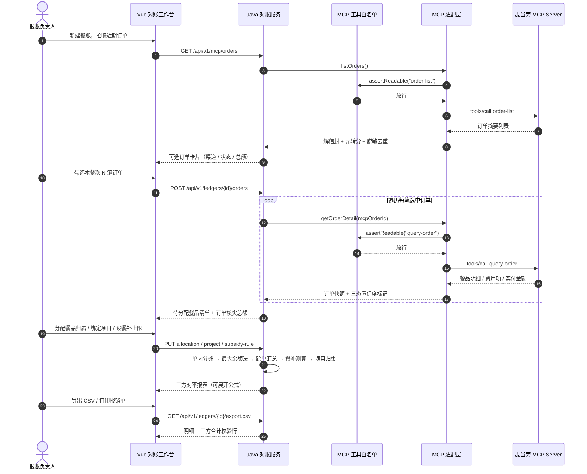
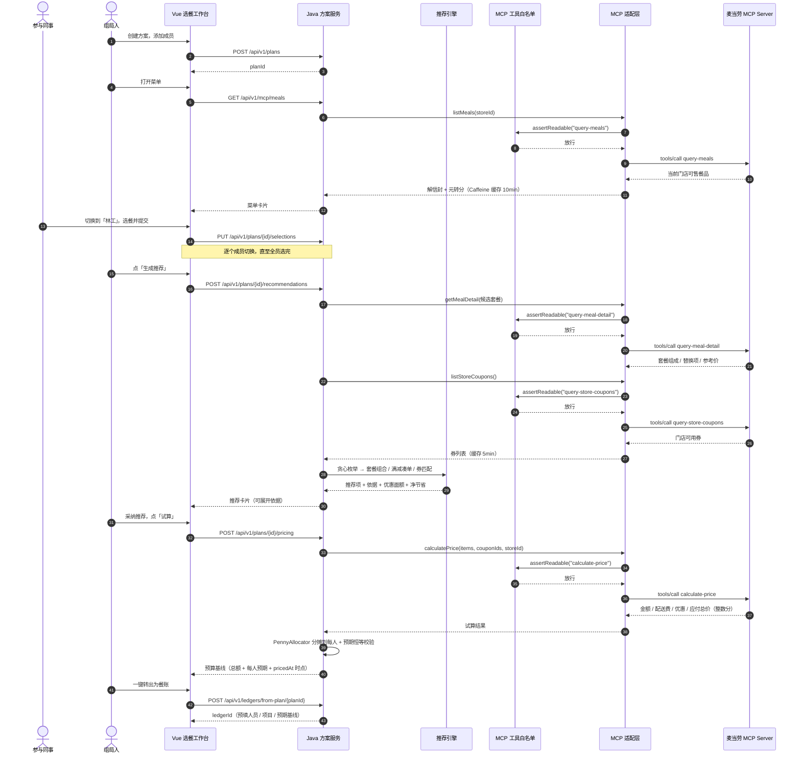

# MCP_INTEGRATION.md — 麦麦餐帐 MCP 集成说明

本文档说明「麦麦餐帐 · 团队餐费对账助手」如何接入麦当劳 MCP Server：接入配置、调用的 Tool 及其职责、完整调用时序、限流与错误码处理，以及业务价值。

---

## 1. MCP Server 接入配置

| 项 | 值 |
|---|---|
| Server 地址 | `https://mcp.mcd.cn` |
| 传输协议 | Streamable HTTP |
| 鉴权方式 | 请求头 `Authorization: Bearer ${MCD_MCP_TOKEN}` |
| 限流 | 每 Token 每分钟 600 次请求 |
| 配置来源 | 服务端环境变量 `MCD_MCP_TOKEN`（见 `mcd-config.example.json` 脱敏模板） |

**Token 安全红线**：

- MCP Token **仅存于服务端环境变量**，`application.yml` 中以 `${MCD_MCP_TOKEN:}` 占位，前端永不接触；
- 仓库中的 `mcp-config.example.json` **只允许环境变量占位符**，不含任何真实凭据；
- 本地真实配置 `mcp-config.json` 已列入 `.gitignore`，不会提交。

**限流与错误码处理**（`McpRateLimiter` / `McpClient`）：

| 场景 | 处理 |
|---|---|
| 令牌桶 | 客户端侧令牌桶控制调用频率 ≤ 600 次/分钟 |
| `HTTP 429` | **指数退避 500ms → 1s → 2s，最多 3 次**；仍失败则抛 `MCP_RATE_LIMITED`(429) |
| `HTTP 401` | 转 `MCP_AUTH_FAILED`(401)，前端给出友好的「Token 失效，请重新配置」引导，**不暴露原始报文** |
| 其他上游异常 | 转 `MCP_UPSTREAM_ERROR`，保留 traceId 便于排查 |
| 缓存 | 订单快照 / 菜单 / 券结果入库或入 Caffeine 缓存后，分摊与导出**不再重复调用 MCP**，既省配额又保证演示可重复 |

**响应信封解包**（`McpEnvelope`）：真实返回为 `result.content[0].text` 中的「字段说明 markdown + 内嵌 JSON 信封」，信封形如 `{"success":true,"code":200,"message":"","datetime":"","traceId":"","data":{...}}`。适配层按三级策略解包：① `structuredContent.data`；② 从 `content[].text` 正则定位 `{"success"` 起点解析信封取 `data`；③ 兜底按纯 JSON 解析。

---

## 2. 核心调用工具矩阵

本项目**只用 7 个只读工具，零写操作**。

| 工具 | 官方定义 | 在本项目中的职责 |
|---|---|---|
| `order-list` | 查询近期到店 / 外送历史订单 | 拉取操作人近期订单摘要（订单号、时间、渠道、状态、总额），供勾选 |
| `query-order` | 查询订单状态和内容明细 | 获取所选订单深度明细（餐品行项、套餐构成、优惠扣减、外送 / 打包费、实付总额），作为**分摊引擎唯一事实数据源** |
| `query-nearby-stores` | 查询附近门店 | 选餐阶段定位可用门店 |
| `query-meals` | 查询当前门店可售餐品 | 选餐输入源：分类 + 扁平餐品列表 |
| `query-meal-detail` | 查询餐品详情 | 套餐组成、可替换选项与参考价 —— 套餐组合推荐的依据 |
| `calculate-price` | 按选购商品列表计算金额 | **餐前**试算当前选购组合（含优惠券）的金额，生成预算基线 |
| `query-store-coupons` | 查询当前门店可用优惠券 | 券匹配推荐与试算入参 |

### 2.1 为何不用 `calculate-price` 算历史账

`calculate-price` 的官方用途是计算**「当前选购商品」的实时价格**。严肃的财务报账必须以交易发生当时的**历史实付金额**为唯一依据——若用当前菜单价倒推旧账单，导出的凭证将与实际支付流水不吻合。

因此本项目的口径是**分阶段划界**：

| 阶段 | 是否可用 `calculate-price` | 金额性质 | 事实源 |
|---|---|---|---|
| **餐前选餐** | ✅ **可用**（正统用途） | **预期金额** | `calculate-price` 当前试算 |
| **餐后对账** | ❌ **禁用** | 历史实付 | `query-order` 返回的实付总额 |

这个划界也正是「预算 → 实际 → 差异」闭环成立的根基：**预期与实际来自两个不同时点、不同口径的正统数据源**，二者的差异才具有真实业务意义。

### 2.2 零写操作原则

`McpToolWhitelist` 采用**默认拒绝**制：仅上表 7 个只读工具放行，命中任何非白名单工具即抛 `MCP_WRITE_TOOL_DENIED`(403) 并写审计日志，**不发出任何网络请求**。

被明确拒绝的写工具包括：`create-order`、`cancel-order`、`auto-bind-coupons`、`draw-lottery`、`mall-create-order`、`party-order-create`、`delivery-create-address` 等。

优惠券在本项目中**只做「查询与推荐」，不做「一键领券」**。产品全程零写操作，从根上杜绝误下单、误扣积分。

### 2.3 A1 真实联调实测结论

以下结论来自用真实 Token 对上述工具的联调核验，已落实到适配层实现：

| # | 实测结论 | 适配层处理 |
|---|---|---|
| 1 | **金额单位因工具而异**：`order-list` / `query-order` / `query-meals` / `query-meal-detail` 侧金额为**元（字符串或数字）**；`calculate-price` 侧为**整数分** | `Money.parseYuanToCents` 统一转分入库，引擎全程只认 `Long` 分 |
| 2 | **`order-list` 的 `comboItemList` 无单品拆解价**：套餐行项只有整体金额，拿不到内部单品单价 | 含 `comboItemList` 的订单置信度降级为 `AGREED_ALLOCATION`，走「套餐作为整体金额单元、用户约定分摊」路径，并在 UI 标注【来源：套餐整体约定均分】 |
| 3 | 订单侧 `price` 字段视为**单价（元）**，行小计 = 单价 × 数量 | `OrderAdapter` 按此换算 `itemTotalCents` |
| 4 | `query-order` 返回的订单状态可能含取消 / 退款态 | 自动过滤已取消订单；无法判定的进 `PENDING_CONFIRMATION` 待确认区 |
| 5 | **`query-store-coupons` 不返回券面额**，只有标题 / 券码 / 适用餐品 | R3 券匹配只做「适用餐品 ∩ 已选餐品」的定性匹配，`discountCents=0`、`netSavingCents=NULL`，**绝不臆造优惠金额** |
| 6 | **`calculate-price` 的响应是「某一固定组合」的快照** | 沙盒层（仅 `mcd.sandbox.enabled=true`）以官方 `query-meals` 抓取值重算小计与 `productList`，保证 demo 数字自洽；真实模式下装配真实 `McpClient`，业务代码零 `if (isSandbox)` |

### 2.4 沙盒镜像：只替换最底层数据源

`McpClientConfig` 按 `mcd.sandbox.enabled` 装配 `McpClient`：`true` → `SandboxMcpClient`，`false` → 真实 `McpClient`。
`MenuAdapter` / `CouponAdapter` / `PriceAdapter` / `OrderAdapter` 与上层服务**完全共用同一份代码**，
唯一差别是最底层的数据来源。因此**沙盒演示走过的每一行代码，都是真实链路会走的代码**；
真实 MCP 不可用（无 Token / 限流）时，产品仍可完整演示。

---

## 3. 调用时序

### 3.1 事后对账链路（主链路）

### 3.2 组队选餐链路（增量）

---

## 4. 业务价值

| 价值点 | 说明 |
|---|---|
| **60 秒完成多人多单对账** | 从「在 Excel 反复凑数」到「勾选订单 → 分配餐品 → 导出报销单」，垫付人的时间成本从半小时降到一分钟 |
| **每一分钱都能展开公式** | `个人餐品 + 共享份额 − 优惠分摊 + 配送等费用 = 个人分摊额`，参与同事可以自己点开看为什么是这个数，不必反复解释 |
| **审计级可解释** | 三态数据置信度（`VERIFIED_HISTORICAL` / `AGREED_ALLOCATION` / `PENDING_CONFIRMATION`）标注每个金额的来源；接口字段缺失不视为故障，而是显式的合规审计点 |
| **精确到分，三方恒等** | 整数分 + 最大余额法，保证 `订单合计 = 人员分摊合计 = 项目归集合计`，尾差必须为 0；对不上进待确认区，不强行抹平 |
| **餐前控预算、餐后清账** | 选餐即生成可核对的预算基线，与事后对账共用同一分摊引擎，点餐完成后一键对照「预算 vs 实际」，形成完整闭环 |
| **零写操作，绝对安全** | 7 个只读工具 + 白名单默认拒绝制，从根上杜绝误下单、误扣积分 |
| **30 秒免 Token 体验** | 沙盒模式在 MCP 边界层替换响应数据，上层引擎与试算服务共用同一份代码，clone 即可跑通完整演示 |

---

## 附：参赛合规说明

- 本项目为麦当劳程序员创意开发大赛参赛作品；
- 全程只读，不调用任何下单 / 领券 / 抽奖类写工具；
- 仓库 `mcp-config.example.json` 仅含环境变量占位符，不含真实 Token；
- 文档中不含任何品牌对比内容。
