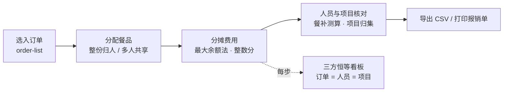
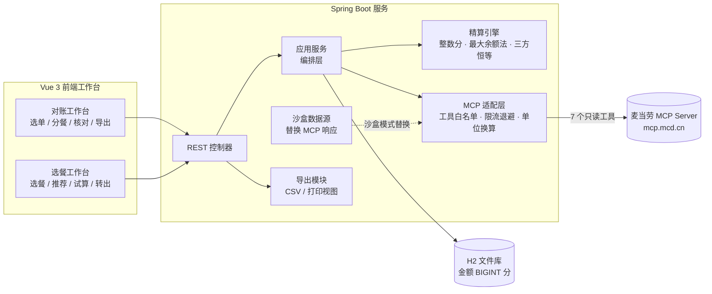

# 麦麦餐帐 · 团队餐费对账助手

> **餐点完了，账也分清了。**

团队加班餐、项目组加餐、行政统一订餐——餐总是要吃，但**吃完了账怎么分清**，一直是垫付人的噩梦。

麦麦餐帐基于麦当劳 MCP 能力，把已发生的麦当劳订单在 60 秒内整理成**按人员、按项目都能核对清楚的费用明细**：精确到分、三方恒等、每一分钱都能展开公式。同时提供**组队选餐**能力：点餐前各自选想吃的，系统推荐更划算的套餐组合与可用优惠，试算出的预算基线可在点餐完成后与实际账单一键对照。

## 目录

- [解决什么问题](#解决什么问题)
- [双主线功能](#双主线功能)
- [可信度四支柱](#可信度四支柱)
- [目标用户](#目标用户)
- [架构](#架构)
- [快速启动](#快速启动)
- [60 秒演示剧本](#60-秒演示剧本)
- [测试证据](#测试证据)
- [MCP 工具矩阵](#mcp-工具矩阵)
- [仓库结构](#仓库结构)
- [License](#license)

---

## 解决什么问题

**餐后对账这件事，至今没有好用的工具。**

点餐前的规划类工具已经很多——选什么、凑什么满减、领哪张券。但**「餐点完了，账怎么分清」几乎是空白**：餐是小王垫付的，订单散落在好几笔，有共享小食、有满减优惠、有外送打包费，六个人分两个项目，报销还要卡餐补标准。

于是垫付人只能在 Excel 里反复凑数：

| 痛点 | 后果 |
|---|---|
| 多笔订单（外卖 + 自提）要手工合并 | 漏一笔、重一笔，账永远对不上 |
| 共享小食不知道该怎么分 | 拍脑袋均分，有人不服 |
| 满减、优惠券、配送费不知道摊给谁 | 分摊比例说不清，报销被打回 |
| 餐费要按项目归集、卡餐补上限 | 标准内 / 超标金额手工拆，易错 |
| 每人不知道自己该摊多少、为什么 | 每次聚餐后都要解释一遍 |

**麦麦餐帐的做法**：让麦当劳 MCP 提供**已核实的历史实付数据**作为唯一事实源，用**整数分 + 最大余额法**做分摊，保证**订单合计 = 人员分摊合计 = 项目归集合计**，尾差必须为 0。60 秒出一份可直接走报销流程的明细。

---

## 双主线功能

### 主线一：事后对账（核心）

> 餐点完了 → 60 秒清账。



| 功能 | 用户操作 | 完成标准 |
|---|---|---|
| F1 选入订单 | 读取近期订单，勾选本餐次订单 | 同一 `mcpOrderId` 重复导入不重复记账；自动过滤已取消订单 |
| F2 分配餐品 | 餐品分给个人；共享部分指定参与人 | 支持整份归人、多人均分；未分配餐品进入「待确认区」，不计入任何合计 |
| F3 分摊费用 | 确认优惠、配送费的分法 | 每笔订单单独结算；优惠 / 配送费按该订单内各人餐品小计为权重分摊；金额可展开依据 |
| F4 人员与项目核对 | 给人员选项目，填写餐补上限 | 人员 / 项目 / 订单三处合计一致；自动拆出「标准内 / 超出标准」 |
| F5 导出费用明细 | 导出 CSV，打开可打印页 | 含订单来源、人员、项目、分摊金额、规则说明与三方合计校验行 |

### 主线二：组队选餐（增量）

> 点餐前先把预算定清楚，点餐后账自然就清了。


选餐的结果不是一份购物车，而是一份**可被事后核对的预算基线**：与事后对账**共用同一个分摊引擎**，点餐完成后一键对照「预算 → 实际 →差异」，让产品从「点完再清账」升级为「点餐前控预算、点餐后清账」的完整链路。

| 功能 | 用户操作 | 完成标准 |
|---|---|---|
| F6 组队建方案 | 建方案，添加成员并绑定项目 | 成员 / 项目可复用对账域同一套结构 |
| F7 各自选餐 | 浏览当前门店菜单，按成员身份选餐 | 支持套餐替换项；**全程不产生任何下单动作** |
| F8 汇总与推荐 | 查看汇总，采纳 / 忽略推荐 | 三类推荐（套餐组合 / 满减凑单 / 可用券），每条给出**依据 + 优惠面额 + 净节省** |
| F9 生成预算基线 | 一键试算 | 输出预期总额与每人预期金额；`Σ 每人预期 = 预期总额`，尾差 0 |
| F10 转入对账 | 一键转出为餐账 | 预填人员、项目、餐次时间 |
| F11 差异对照 | 查看预算 vs 实际 | 总额级 + 人员级差异，正号 = 超预算 |

---

## 可信度四支柱

| # | 支柱 | 落地方式 |
|---|---|---|
| P1 | **精确到分** | 全链路整数分（`Long`，单位：分），引擎内禁止浮点；按比例分摊用**最大余额法**消尾差，平局按 `personId` 字典序保证幂等 |
| P2 | **三方恒等** | 任何状态下 `订单合计 = 人员分摊合计 = 项目归集合计`，尾差必须为 `0`；对不上进「待确认」而非强行抹平 |
| P3 | **来源可解释** | 每个金额可展开计算依据，并带数据来源审计标签（`VERIFIED_HISTORICAL` / `AGREED_ALLOCATION` / `PENDING_CONFIRMATION`） |
| P4 | **纯读安全** | **只用 7 个只读 MCP 工具，零写操作**。工具白名单默认拒绝，命中非白名单即抛 `MCP_WRITE_TOOL_DENIED` 并写审计日志，**不发出任何网络请求** |

**示例：林工的费用是怎么算出来的**

```text
个人套餐          35.00
+ 订单1共享麦乐鸡   9.75
- 订单1优惠分摊     7.94
+ 订单1配送费分摊   2.38
+ 订单2共享薯条     4.67
- 订单2优惠分摊     0.70
= 实摊           43.16   （标准内 35.00 / 超标 8.16）
```

**尾差算法演示点**：薯条 2800 分 ÷ 6 人 = 466 分余 4 分，余数派发后为 `467 × 4 人 + 466 × 2 人` —— 最大余额法保证分毫不差。

---

## 目标用户

| 角色 | 痛点 | 产品价值 |
|---|---|---|
| 垫付人（Tech Lead / PM / 行政） | 垫付后要在 Excel 反复凑数：多笔外卖、共享小食、满减优惠、配送费、跨项目归集、餐补超标拆算 | 60 秒完成对账，导出即可报销 |
| 参与同事 | 不知道自己该摊多少、为什么是这个数 | 每人可展开公式与来源，明明白白 |
| 项目负责人 / 财务 | 餐费要按项目归集、卡餐补标准 | 项目维度汇总 + 标准内 / 超标自动拆算 |
| 围观开发者 | 想看懂了再点星 | 沙盒模式 30 秒免 Token 体验完整演示 |

---

## 架构



**分层依赖规则**：引擎 ← 应用服务 ← Web；MCP 适配层只被应用服务调用。真实接口字段变化时只改适配层，引擎单测不受影响。

**沙盒模式**：`SandboxPlanFixture` / `DemoLedgerController` 在 MCP 边界层替换响应数据，**上层三个 Adapter、推荐引擎、试算服务全部与真实链路共用同一份代码**，业务逻辑中不存在 `if (isSandbox)` 分支。沙盒演示的字段结构来自真实联调抓取的响应脱敏裁剪，不手工臆造。

---

## 快速启动

> **30 秒跑起来，无需 MCP Token** —— 沙盒模式内置基准数据，打开即见完整演示。配置 Token 后随时切换真实链路。

### 环境要求

| 依赖 | 版本 |
|---|---|
| JDK | 17 或更高 |
| Node.js | 18 或更高（建议 20+） |
| pnpm | 8 或更高 |
| Maven | 3.8+（或使用仓库自带 `./mvnw`） |

### 1. 构建后端

```bash
cd mcd-ledger-server
mvn package
```

### 2. 构建前端并打入后端

```bash
cd mcd-ledger-web
pnpm install
pnpm build
# 将构建产物拷入 Spring Boot 静态资源目录
cp -r dist/* ../mcd-ledger-server/src/main/resources/static/
```

### 3. 启动

```bash
java -jar mcd-ledger-server/target/mcd-ledger-server-0.1.0.jar --server.port=8080
```

打开 <http://localhost:8080> —— **直接进入沙盒演示**，无需任何配置。

### 4. 接入真实麦当劳 MCP（可选）

沙盒之外，产品可切换真实链路。MCP Token **只存服务端环境变量**，前端永不接触：

```bash
export MCD_MCP_TOKEN=<你的麦当劳 MCP Token>
java -jar mcd-ledger-server/target/mcd-ledger-server-0.1.0.jar --server.port=8080
```

配置文件使用脱敏模板 `mcp-config.example.json`，其中 Token 以环境变量占位符形式出现，不含任何真实凭据：

```json
{
  "mcp": {
    "serverUrl": "https://mcp.mcd.cn",
    "token": "${MCD_MCP_TOKEN}"
  }
}
```

H2 控制台地址：<http://localhost:8080/h2-console>（JDBC URL `jdbc:h2:file:./data/ledger`，用户名 `sa`，密码留空）。

---

## 60 秒演示剧本

> 沙盒数据即单元测试固定用例（两单 · 六人 · 两项目，餐补上限 ¥35.00/人）。录屏重点如下。

| # | 步骤 | 时间 |
|---|---|---|
| 1 | 打开页面，恒等看板显示 `¥228.00 = ¥228.00 = ¥228.00`，尾差 `¥0.00` | 5s |
| 2 | 展开 **林工** 明细，逐项展示公式 | 15s |
| 3 | 餐补上限从 `¥35.00` 拖到 `¥40.00`，全表标准内 / 超标毫秒级联动 | 10s |
| 4 | 切换「餐补含配送费」开关，观察王工由超标 `¥2.12` 变为标准内 | 10s |
| 5 | 点开订单 2 的薯条分摊，展示 `¥4.67 × 4 人 + ¥4.66 × 2 人` 的分币尾差算法 | 10s |
| 6 | 导出 CSV / 打印报销单收尾 | 10s |

**选餐增量补充镜头**（沙盒方案 `planId=1`，六人 · 九种餐品 · 官方菜单价合计 `¥196.50`）：

| # | 步骤 | 看点 |
|---|---|---|
| 7 | 打开选餐工作台 | 方案合计 `¥196.50`；推荐区首条「满 200 减 30 净省 ¥26.50」，次条「麦辣鸡腿汉堡三件套 ×2 省 ¥24.00」 |
| 8 | 点「官方核价」 | 官方 `calculate-price` 返回 `¥196.50`；每人均摊 `36.00 / 36.00 / 33.00 / 35.00 / 36.50 / 20.00`，页面自校验「Σ 每人预期 = 官方总额，尾差 0」 |
| 9 | 采纳一条推荐 → 转出为餐账 | `POST /api/v1/ledgers/from-plan/1`，人员 1:1、项目预填、基线随行 |
| 10 | 打开对账工作台（沙盒账 id=1 已带基线） | 「预算 vs 实际」：预期 `¥196.50` vs 实际 `¥228.00` → 超支 `¥31.50`，人员级差异之和与总额一致 |

> 券匹配类推荐**不给金额**（`netSavingCents` 为 `NULL`）：券面额是官方的，但能否叠加 / 是否满足门槛无从验证，系统宁可定性展示也不臆造优惠。

---

## 测试证据

| 层 | 数量 | 覆盖 |
|---|---|---|
| 后端单元测试 | **105 项，全绿** | 最大余额法尾差与幂等、四方分摊流水线、餐补测算、三方恒等校验、MCP 单位换算与白名单、**R1/R2/R3 净节省（含负例与 R6 违规断言）**、**R5 预期恒等（尾差 0 + stale 判定）**、**转出与差异对照（含未关联 / 无基线两条错误分支）** |
| 前端类型与构建 | `vue-tsc --noEmit` + `vite build` 均通过 | 对账工作台与选餐工作台、推荐面板、预算基线、差异看板 |
| 前端联调断言 | **42 项，全过** | 对账工作台与选餐工作台渲染、规则联动、尾差展示 |
| 沙盒基准复现 | 对账侧精确复现 `22800` 分 / 尾差 `0`；选餐侧 `19650` 分 / 核价尾差 `0` | 与单元测试固定用例同一份数据（选餐种子 code 与单价**全部取自官方 `query-meals` 抓取值**） |

---

## MCP 工具矩阵

只用 **7 个只读工具**，零写操作。详见 [`MCP_INTEGRATION.md`](./MCP_INTEGRATION.md)。

| 工具 | 用途 | 所属主线 |
|---|---|---|
| `order-list` | 查询近期订单摘要，供勾选 | 事后对账 |
| `query-order` | 订单深度明细，**分摊引擎唯一事实数据源** | 事后对账 |
| `query-nearby-stores` | 附近门店查询 | 组队选餐 |
| `query-meals` | 当前门店可售餐品列表，选餐输入源 | 组队选餐 |
| `query-meal-detail` | 套餐组成与可替换选项 | 组队选餐 |
| `calculate-price` | **餐前**试算当前选购组合价格，生成预算基线 | 组队选餐 |
| `query-store-coupons` | 当前门店可用券 | 组队选餐 |

**关于 `calculate-price` 的边界**：严肃的财务报账必须以交易发生当时的**历史实付金额**为唯一依据。因此事后对账**不用** `calculate-price` 倒推历史账单；它只用于**餐前**试算——这正是其官方定义「计算当前选购商品的实时价格」的正统用途。

---

## 仓库结构

```
mcd-meal-ledger/
├── README.md                    # 项目介绍 / 安装方法 / 使用示例 / 目标用户
├── MCP_INTEGRATION.md           # MCP Server / Tool / 调用流程 / 业务价值
├── workbuddy.md                 # WorkBuddy 开发过程记录
├── mcp-config.example.json      # 脱敏配置，只允许环境变量占位符
├── .gitignore                   # 忽略 target/ dist/ data/ node_modules/ 本地配置
├── mcd-ledger-server/           # Spring Boot 3.2.5 后端（Java 17）
│   ├── pom.xml
│   └── src/
│       ├── main/java/com/mcd/
│       │   ├── ledger/          # 对账域：common / config / domain / dto / engine / mapper / mcp / service / web
│       │   └── plan/            # 选餐域：domain / dto / engine（+rule）/ mapper / mcp / sandbox / service / web
│       ├── main/resources/
│       │   ├── application.yml  # 含 R1 套餐构成 / R2 满减档位「活动规则表」（不含任何价格）
│       │   ├── db/              # schema.sql + data-sandbox.sql（每次启动重建，保证沙盒可复现）
│       │   └── sandbox/         # MCP 响应脱敏样本（菜单 / 餐品详情 / 试算 / 券 / 订单）
│       └── test/java/com/mcd/   # 引擎 / 服务 / MCP / 推荐 / 核价 / 差异对照 单测
└── mcd-ledger-web/              # Vue 3.5 + Element Plus 前端（TypeScript + Vite 6）
    ├── package.json
    └── src/
        ├── api/                 # http / ledger / plan
        ├── components/          # 恒等看板 / 订单卡片 / 人员表 / 餐补规则面板 …
        ├── router/  store/  types/  utils/
        └── views/
            ├── ledger/          # 对账工作台 + 预算 vs 实际 + 打印视图
            └── plan/            # 选餐工作台 + 成员条 + 菜单浏览 + 选餐汇总 + 推荐面板 + 预算基线 + 转出弹窗
```

> **说明**：源码位于 `mcd-ledger-server/` 与 `mcd-ledger-web/` 两个模块内（而非仓库根的 `src/`），均为可运行、可构建的源代码。

---

## License

建议采用 **MIT License**（待项目负责人确认后补充 `LICENSE` 文件）。

> 本项目为麦当劳程序员创意开发大赛参赛作品，与麦当劳品牌无隶属关系；文中不含任何品牌对比内容。
